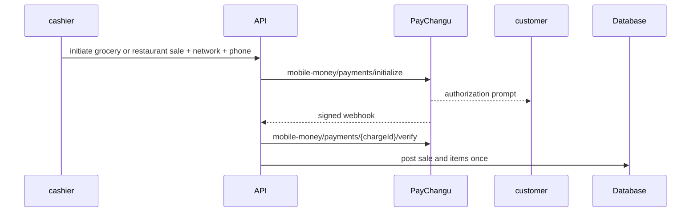

# PayChangu integration

The grocery and restaurant checkouts use PayChangu Mobile Money Direct Charge.
Secret keys remain in the backend. A cashier submits a sale draft to
`POST /api/grocery/payments/initiate` or
`POST /api/restaurant/payments/initiate`; the backend recalculates prices and
creates a pending attempt. PayChangu then prompts the customer's Airtel Money
or TNM Mpamba phone.

The webhook at `POST /api/webhooks/paychangu` validates the `Signature` HMAC,
then the backend calls the direct-charge verification endpoint again. Only a
verified success creates the `sales` and `sale_items` rows, so pending or
failed attempts cannot reduce inventory. `GET /api/grocery/payments/:reference/status` and
`GET /api/restaurant/payments/:reference/status` are the
polling/reconciliation fallbacks.

Payment attempts and webhook hashes are unique and the posting transaction
locks the attempt. Repeated webhooks therefore return the existing outcome and
cannot create a second sale.

## Statuses

`PENDING` and `PROCESSING` are not sales. `SUCCEEDED` is posted exactly once;
`FAILED`, `CANCELLED`, and `EXPIRED` are not revenue.
