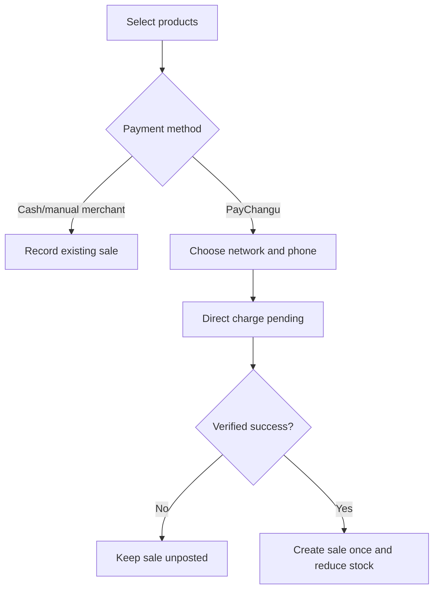

# Payment workflow

Cash, manually recorded Airtel Money, and manually recorded TNM Mpamba sales
are recorded immediately using the existing checkout. PayChangu is different:
the cashier selects the network, enters the customer's phone number, and
requests payment. The customer authorizes the prompt on their own phone; the
cashier must never request a PIN.

The checkout remains pending while PayChangu is processing. A signed webhook
and an independent verification request are required before the backend
creates the sale. At that point inventory is reduced by the existing tracked
sale ledger. Failure, cancellation, expiry, mismatch, or timeout does not
create a sale.

