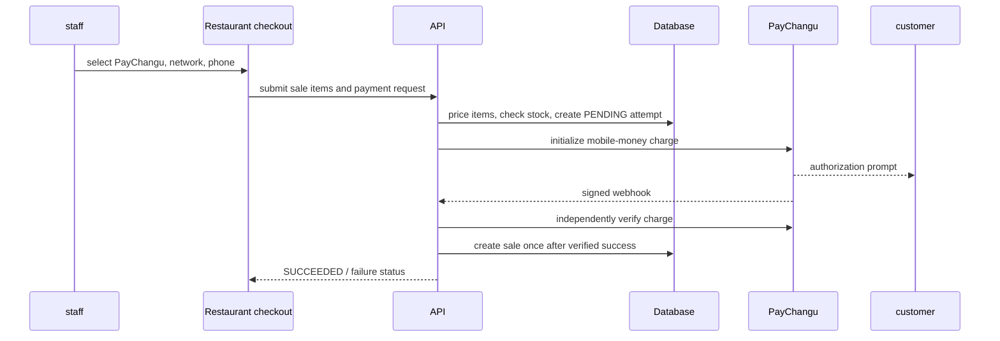

# Restaurant payment workflow

Restaurant sales use the existing Trading Workspace. Cash, manually recorded
mobile money, bank, credit, and meal-card payments continue to be recorded
through the existing sales endpoint. PayChangu is an additional option and is
available when the backend has Direct Charge credentials.

The backend calculates the total from the current product prices and rejects
frontend amount manipulation. A pending, failed, cancelled, expired, or
verification-mismatch attempt does not create a sale or reduce inventory.
Webhook payload hashes, provider event IDs, request IDs, and payment attempts
are idempotent; the posting transaction locks the attempt before creating the
sale.

Staff should wait for the customer to authorize the Airtel Money or TNM Mpamba
prompt. The checkout polls the status endpoint while the webhook provides the
server-side notification path. If the status remains pending, staff should
refresh the payment status rather than record a second sale. Successful
restaurant payments appear in the normal sales and financial reports as
`PAYCHANGU`.

## Endpoints

- `POST /api/restaurant/payments/initiate?business=RESTAURANT_A|RESTAURANT_B`
- `GET /api/restaurant/payments/:reference/status?business=RESTAURANT_A|RESTAURANT_B`
- `POST /api/webhooks/paychangu`

The initiation endpoints require an authenticated user with access to the
restaurant section. The webhook validates the PayChangu signature and then
performs an independent provider verification.
